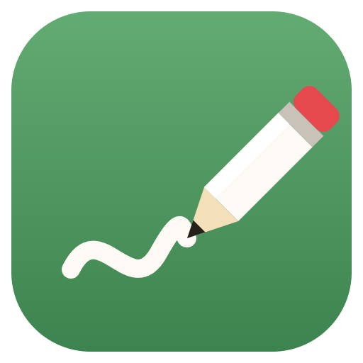
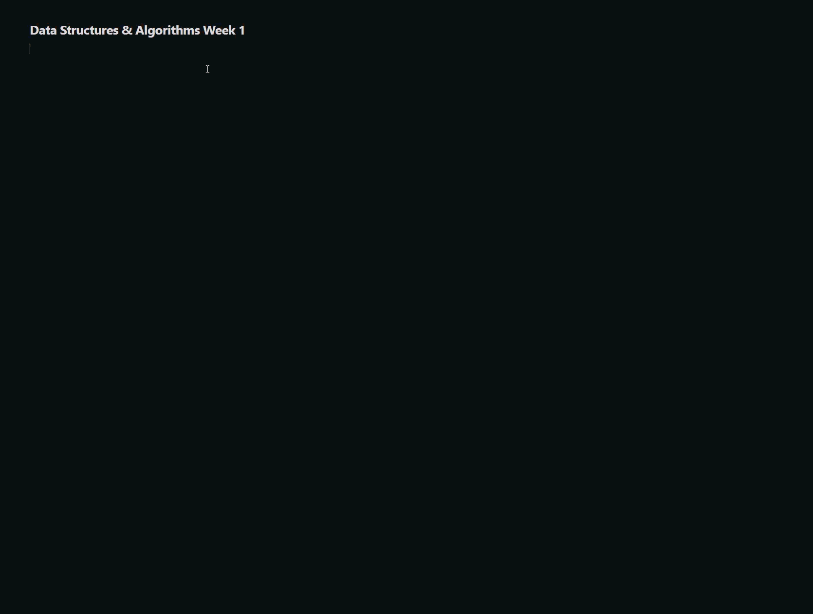
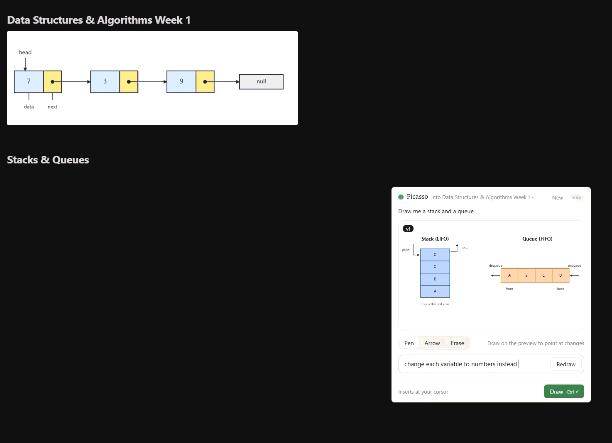
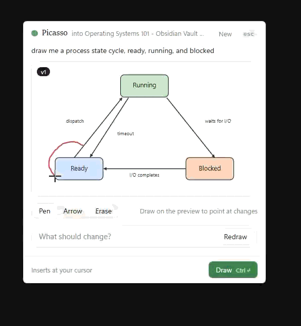
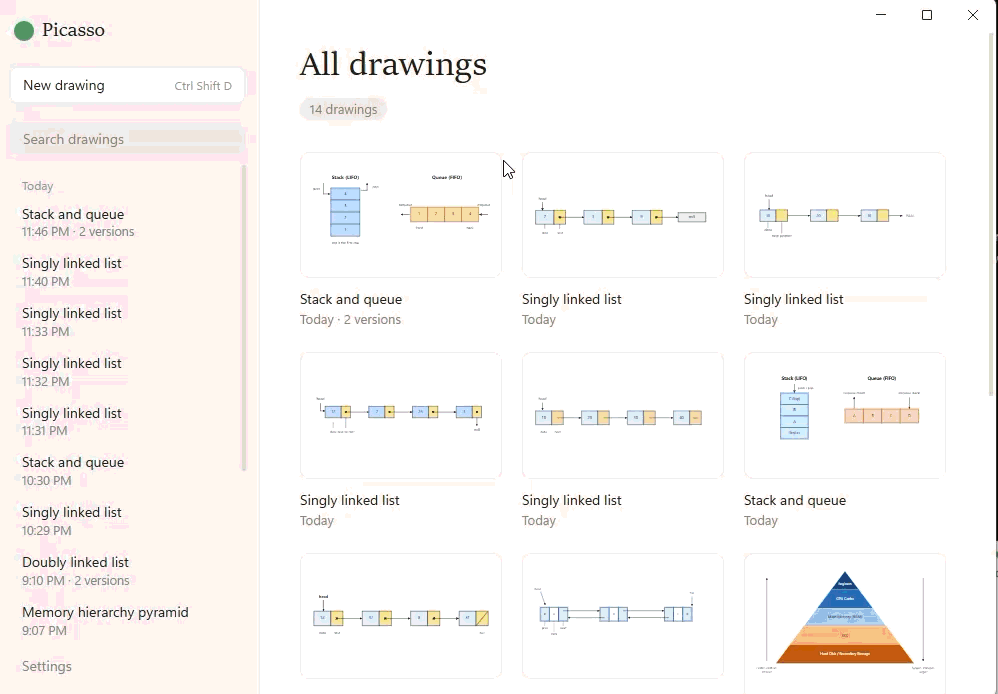

<p align="center">
  
</p>

<h1 align="center">Picasso</h1>

<p align="center">
  <strong>No time to draw your notes during lecture? No problem, Picasso is here!</strong><br />
  Press a hotkey, describe a diagram, and Picasso draws it with Claude and pastes it right where you're typing.
</p>

[INSERT HERE]

<!-- GIF (hero): typing notes in Google Docs or Obsidian → Ctrl+Shift+D → type "the five-state process model" → Generate → Draw → the diagram lands at the cursor. Keep it under ~15 seconds. -->

## How it works

1. **You're taking notes.** Put your cursor where the diagram should go.
2. **Press <kbd>Ctrl</kbd>+<kbd>Shift</kbd>+<kbd>D</kbd>.** The Picasso panel slides in on the right, and remembers which window you were typing in.
3. **Describe it.** "A linked list with 3 nodes", "the Krebs cycle as a loop with the 8 steps labeled", "a TCP three-way handshake."
4. **Tweak it.** Type a change, or draw on the preview to point at what you mean.
5. **Press Draw** (or <kbd>Ctrl</kbd>+<kbd>Enter</kbd>). The panel hides and the diagram is pasted into your notes.

## Features

### Quick-draw panel

A hotkey opens a small panel from anywhere in Windows. It shows which document it'll paste into ("Data Structures & Algorithms Week 1"), and a pencil sketches while Claude draws.



<!-- GIF: from another app, Ctrl+Shift+D → the panel appears with "into …" → type a prompt → Generate → the pencil animation → the diagram appears. -->

### Redraw with a note

Not quite right? Type what should change ("make the Waiting state red") and press **Redraw**. Claude edits the diagram on screen instead of starting over, so the rest of it stays put. Leave the box empty and press Redraw to get a fresh take instead.



<!-- GIF: a finished diagram → type "make the Waiting state red" → Redraw → only that box changes (v1 → v2). -->

### Draw on the preview

Use **Pen**, **Arrow** and **Erase** to mark up the diagram in red: circle the part you mean, or draw an arrow from one place to another. Then add a note, and Claude gets a picture of your marks along with it.



### History

Every drawing and each of its versions is saved. The main window groups them under Today, Yesterday, Last week and Older, with search. Open one to see its **Thread**: each version, what you asked for, the marks you drew, and a **Copy** button to paste any version again.



## Getting started

### What you need

- **Windows 10 or 11.** Auto-paste uses Windows functions.
- **Node.js** 20.19+ or 22.12+ (developed on Node 24).
- **A Claude API key** from the [Anthropic Console](https://console.anthropic.com/). Each person uses their own key. A diagram costs a few cents.

### Run it

```bash
git clone https://github.com/ryandev1004/Picasso.git
cd Picasso
npm install
npm run dev
```

Then open **Settings** in the main window and paste your API key. It's encrypted with your Windows account and stored only on your PC.

> An installer for Windows is on the way. Until then, run it from source as above.

## Keyboard shortcuts

| Keys                                          | What it does                               |
| --------------------------------------------- | ------------------------------------------ |
| <kbd>Ctrl</kbd>+<kbd>Shift</kbd>+<kbd>D</kbd> | Open or close the panel, from anywhere     |
| <kbd>Enter</kbd>                              | Generate, or Redraw once there's a diagram |
| <kbd>Ctrl</kbd>+<kbd>Enter</kbd>              | Draw: paste the diagram into your notes    |
| <kbd>Esc</kbd>                                | Hide the panel (your diagram is kept)      |

## Scripts

| Command                          | What it does                                                             |
| -------------------------------- | ------------------------------------------------------------------------ |
| `npm run dev`                    | Start Picasso with hot reload                                            |
| `npm run build`                  | Typecheck, then build into `out/`                                        |
| `npm run typecheck`              | Typecheck the main process and the Vue windows                           |
| `npm run format`                 | Format everything with Prettier                                          |
| `npm run icons`                  | Rebuild the tray and app icons from `resources/*.svg`                    |
| `node scripts/seed-drawings.mjs` | Add sample drawings to try the History screens (`--remove` deletes them) |

## Project structure

```
src/
├── main/                 Electron's main process (Node)
│   ├── index.ts          startup: windows, hotkey, tray
│   ├── ipc.ts            every request the windows can make
│   ├── ipcChecks.ts      checks everything that arrives from the windows
│   ├── agent/            talking to Claude: prompts and requests
│   ├── native/           Windows functions (via koffi) for auto-paste
│   ├── paste/            the clipboard, and pasting into the right window
│   ├── storage/          drawings history and the encrypted API key
│   ├── system/           tray, global hotkey, launch at login
│   └── windows/          the main window and the panel
├── preload/              the bridge between the windows and main (window.picasso)
├── shared/               the contract both sides share (ipc.ts)
└── renderer/             the Vue windows
    └── src/
        ├── lib/          helpers: dates, labels, SVG → PNG
        ├── styles/       base.css: colors and shared styles
        └── windows/
            ├── main/     drawings list, grid, Thread, Settings
            └── panel/    the quick-draw panel and the drawing layer
resources/                icons (SVG sources and the generated .ico/.png)
scripts/                  icon generator and sample-drawings seeder
```

## Built with

- [Electron](https://www.electronjs.org/) with [electron-vite](https://electron-vite.org/)
- [Vue 3](https://vuejs.org/) and TypeScript
- [Claude](https://www.anthropic.com/claude) through the [Anthropic TypeScript SDK](https://github.com/anthropics/anthropic-sdk-typescript). The model and settings are in [`src/main/agent/prompts.ts`](src/main/agent/prompts.ts).
- [koffi](https://koffi.dev/) for calling Windows functions from TypeScript

## Privacy

- **Your API key** is encrypted with Windows (Electron's `safeStorage`) and saved in `%APPDATA%\picasso`. The Vue windows can't read it back.
- **Your drawings** are plain files in `%APPDATA%\picasso\drawings`, on your PC only.
- **What's sent to Claude:** your description and changes, the current diagram, and, when you draw marks, a picture of the diagram with your marks on it.

## Troubleshooting

- **The hotkey doesn't open the panel:** another app may already use <kbd>Ctrl</kbd>+<kbd>Shift</kbd>+<kbd>D</kbd>. The main window shows a warning when that happens. Change `PANEL_HOTKEY` in `src/main/system/shortcuts.ts`.
- **Nothing got pasted:** the diagram is still on your clipboard, so press <kbd>Ctrl</kbd>+<kbd>V</kbd>. Text-only apps (Notepad, terminals) can't hold images, and Windows won't let Picasso paste into apps running as administrator.
- **"Add your Claude API key in Settings first":** paste your key in **Settings**. If you saved one before and it stopped working, save it again.

## License

MIT © Ryan Sullivan
